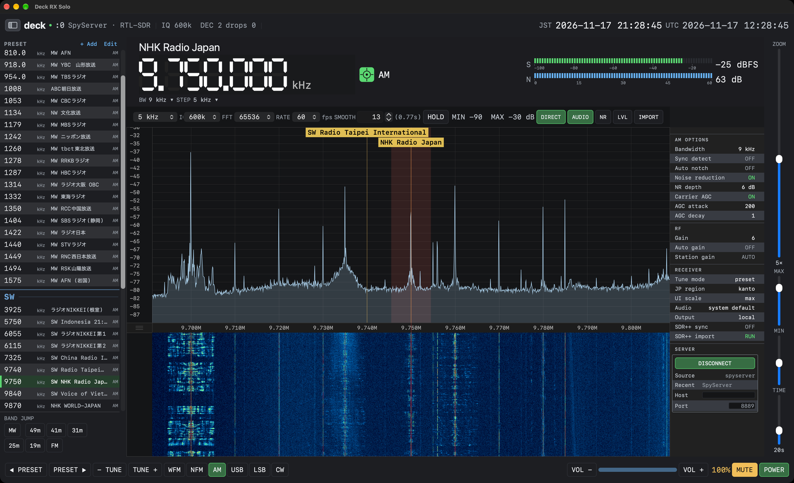
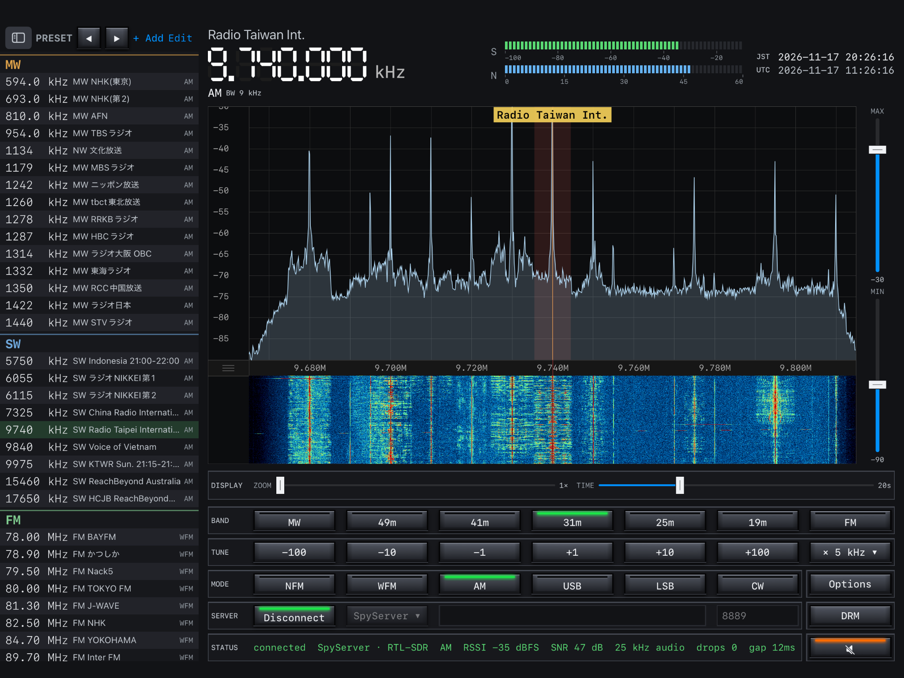

# Deck RX

A shortwave and broadcast-band receiver for a remote
[SpyServer](https://airspy.com/) — as a Stream Deck + plugin, as a Mac app, and
as an iPad app. They share the demodulators and the station databases; they
differ in what is holding the radio.

**[Deck RX Solo](docs/solo.md) — Mac app**

**[Deck RX](docs/ipad.md) — iPad app**

## Which one do you want

| | What it is | Needs |
| --- | --- | --- |
| **[Deck RX Solo](docs/solo.md)** — Mac app | The whole receiver in one bundle. Start here if you just want to listen. | a SpyServer or an `rtl_tcp` server on the network (an Airspy HF+ or an RTL-SDR such as the Blog V4 behind it), or an Airspy HF+ on an Apple-silicon Mac's own USB |
| **[Deck RX](docs/plugin.md)** — Stream Deck + plugin | Fourteen actions and the encoder dials, driving the radio from the deck. The original. | a Stream Deck +, macOS on Apple silicon (the Stream Deck app brings its own Node) |
| **[Deck RX](docs/native-app.md)** — Mac front-end | A window onto the plugin's receiver. Draws what the plugin is doing; has no receiver of its own. | the plugin, on the same Mac |
| **[Deck RX](docs/ipad.md)** — iPad app | A receiver on the tablet, demodulating there. | a SpyServer or an `rtl_tcp` server on the network, or an RTL-SDR or an Airspy HF+ plugged into an M-series iPad |

Both Mac apps are called "Deck RX" and "Deck RX Solo"; the plugin and the iPad
app are "Deck RX" too. Which is meant is usually clear from the context, and
where it is not, this page says which.

Each of them runs on its own. Keeping presets and per-station gains the same
across several of them is optional and needs a small [sync hub](docs/sync.md)
on one always-on Mac; without one, nothing is missing.

## Requirements

| | Runs on | Processor | Also needs |
| --- | --- | --- | --- |
| **Deck RX Solo** | macOS 12 or later | Apple silicon or Intel (one universal app) | a SpyServer or `rtl_tcp` server on the network — or, on Apple silicon only, an Airspy HF+ on the Mac's own USB |
| **Deck RX** (Mac front-end) | macOS 12 or later | Apple silicon or Intel | the Stream Deck plugin, running on the same Mac |
| **Deck RX** (Stream Deck plugin) | macOS 11 or later | Apple silicon (Intel untested) | the Stream Deck app 7.1 or later, a Stream Deck +; to build it, MacPorts `portaudio` and `libsamplerate` |
| **Deck RX** (iPad app) | iPadOS 17 or later | any iPad that runs it; a receiver on the iPad's own USB needs an M-series iPad | building from source and signing with your own Apple developer account — it is not on the App Store |

Solo from the dmg needs nothing installed besides. The plugin and the iPad app
are built from source, as Solo can be; [what to install](docs/build-install.md#what-to-install)
lists the MacPorts packages and Apple tools for each.

The server side is a Linux machine with the receivers on USB, running
SpyServer — here Ubuntu 24.04 (aarch64) in a VM; see
[server setup](docs/server-setup.md).

### Which receiver, which way

How each app reaches a receiver: through a SpyServer, through `rtl_tcp`, or
directly on its own USB. ○ works, × does not.

| | Airspy HF+ via SpyServer | RTL-SDR via SpyServer | RTL-SDR via `rtl_tcp` | Airspy HF+ on USB | RTL-SDR on USB |
| --- | :---: | :---: | :---: | :---: | :---: |
| **Deck RX** (Stream Deck plugin) | ○ | ○ | ○ | × | × |
| **Deck RX Solo** on Apple silicon | ○ | ○ | ○ | ○ | × |
| **Deck RX Solo** on Intel | ○ | ○ | ○ | × | × |
| **Deck RX** (iPad app) on an M-series iPad | ○ | ○ | ○ | ○ | ○ |
| **Deck RX** (iPad app) on any other iPad | ○ | ○ | ○ | × | × |

- `rtl_tcp` serves RTL-SDR dongles only, which is why it has no Airspy HF+ column.
- On USB, one app owns the receiver. Through a SpyServer several can share it:
  the first to connect tunes, the others listen (and say LISTEN ONLY).
- Solo's USB source needs libairspyhf, which is linked into the Apple-silicon
  half of the universal app only.
- The iPad's USB sources come from a DriverKit driver the build carries
  ([native-app/rtlusb](native-app/rtlusb/README.md)). Only M-series iPads run
  DriverKit drivers; on any other iPad the sources are listed but do not open.
- The Mac front-end has no receiver of its own; it shows the plugin's.
- Tested with an Airspy HF+ Discovery and an RTL-SDR Blog V4.

Tested on (November 2026):

| Machine | OS | Runs |
| --- | --- | --- |
| Mac Studio (2025, M4 Max) | macOS 27.2.1 | plugin, Deck RX, Solo |
| Mac mini (2024, M4) | macOS 27.2.1 | plugin, Deck RX, Solo; also hosts the SpyServer VM |
| MacBook Neo (2026, A18 Pro) | macOS 27.2.1 | Solo |
| MacBook Air (11-inch, Early 2015, Intel Core i7) | macOS 12.7.6 | Solo |
| iPad Pro 12.9-inch (5th generation, M1) | iPadOS 27 | iPad app, with an RTL-SDR or Airspy HF+ on its USB too |
| iPad mini (6th generation, A15) | iPadOS 27 | iPad app |

## Download

[**Deck RX Solo 1.14**](https://github.com/soresore19xx/deck-rx/releases/latest)
— signed and notarised, universal, macOS 12 or later. Drag it to Applications;
the image has an uninstaller in it. Everything else is built from source, and
so is Solo if you would rather: `native-app/build-app.sh solo`.

## What it does

Tuned by frequency or from a preset list, with station names looked up from a
Japanese database and the international EIBI schedule. AM with a carrier AGC,
narrow and wide FM (the wide one in stereo, with a real pilot PLL), USB, LSB and
CW. The spectrum and the waterfall are drawn where the ear is rather than where
the samples are, so what is seen lines up with what is heard.

Two decoders sit beside the receiver in Solo: **HF weather fax** (JMH charts)
and **DRM**, the shortwave digital mode. The iPad app has DRM too. DRM is
optional and fetched separately — see [docs/solo.md](docs/solo.md).

The audio path is the part that took the longest. Two free-running crystals
drift apart by tens of parts per million, and a naive path either creeps into
seconds of delay or starves into clicks over a long session; the answer is an
adaptive resampler in a control loop. That story is in
[docs/plugin.md](docs/plugin.md); Solo and the iPad app play through the same
kind of loop. (The Mac front-end plays nothing itself.)

## Documentation

The four products, each in full:

- [Deck RX Solo](docs/solo.md) — the standalone Mac receiver
- [Deck RX plugin](docs/plugin.md) — the Stream Deck + plugin
- [Deck RX front-end](docs/native-app.md) — the Mac window onto the plugin
- [Deck RX for iPadOS](docs/ipad.md)

And the rest:

- [Sync](docs/sync.md) — presets and per-station gains kept in step across the plugin, Solo and the iPad through an optional sync hub on any always-on Mac, each device's own files as its cache
- [Repository layout](docs/repository-layout.md)
- [Build & install](docs/build-install.md)
- [Server-side setup (SpyServer on Linux ARM/aarch64)](docs/server-setup.md)
- [Dial layouts](docs/dial-layouts.md) — per-plugin LCD screenshots + per-row UI explanations
- [Architecture notes](docs/architecture.md) — dial details, signal-path implementation, internal mechanisms
- [Station-name auto-lookup](docs/station-db.md) — JP DB scraper + EIBI integration, alias rules, NHK channel inference + transmitter-site + callsign annotation
- [Data sources & attribution](docs/data-sources.md) — Japan-only sources (総務省 MIC / 関東総通局 / 沖縄総通局) plus the international EIBI shortwave DB; license terms + refresh scripts
- [Debug helpers](docs/debug-helpers.md) — LCD dump / lint / compare-baseline scripts

## Credits / References

The DSP algorithms and the LCD UI are inspired by / ported from two open-source projects:

- **[SDR++](https://github.com/AlexandreRouma/SDRPlusPlus)** by Alexandre Rouma — Carrier AGC (`dsp::loop::AGC` + `dsp::demod::AM` CARRIER mode), FMIF noise reduction, SpyServer protocol layout, runtime tune sequence.
- **[ATS-Mini](https://github.com/esp32-si4732/ats-mini)** by the esp32-si4732 project — segmented N (SNR) / S (RSSI) bar styling, metallic dial-knob graphic, EIBI shortwave schedule consumer.
- **Stream Deck SDK** — [@elgato/streamdeck](https://www.npmjs.com/package/@elgato/streamdeck) by Elgato.
- **[drm-receiver](https://github.com/JvanKatwijk/drm-receiver)** by Jan van Katwijk — the DRM decoder Solo links, with Qt taken out of it. Fetched and patched by `native-app/drm/fetch.sh`; nothing of it is checked in here.
- **[RTL-SDR-USB-iPadOS](https://github.com/arvedviehweger/RTL-SDR-USB-iPadOS)** by Arved Viehweger (Apache-2.0), on **[gnuradio4-blocks](https://github.com/gnuradio/gnuradio4-blocks)** (MIT) — the DriverKit driver the iPad app carries for an RTL-SDR on its own port, with an R828D PLL fix of ours. Fetched, patched and built by `native-app/rtlusb/build-driver.sh` ([README](native-app/rtlusb/README.md)); nothing of it is checked in here.

If the upstream ATS-Mini URL has moved, please file an issue.

## License

GPL-3.0-or-later. See [LICENSE](LICENSE).

deck-rx contains ports / re-implementations of algorithms from [SDR++](https://github.com/AlexandreRouma/SDRPlusPlus) (GPL-3.0-or-later), so the project is licensed under the same terms — fork / modify / redistribute freely under GPL-3.0+.

The optional DRM decoder is [drm-receiver](https://github.com/JvanKatwijk/drm-receiver), GPL-2.0-or-later, which the "or later" makes compatible with this. Its audio needs **fdk-aac**, whose Fraunhofer licence grants no patent rights and therefore does not combine with the GPL in a distributed binary — the same reason ffmpeg calls a `--enable-gpl --enable-nonfree` build unredistributable. Publishing source is unaffected and is all this repository does, but **a binary built with DRM enabled must not be passed on**. Building and running one yourself triggers no obligation at all.
