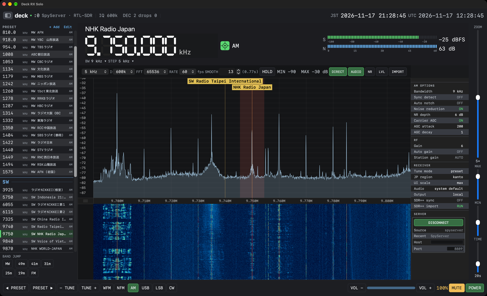
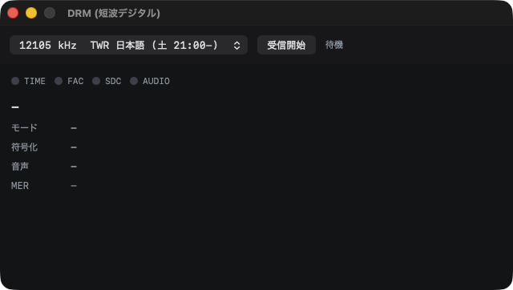

# Deck RX Solo — the standalone receiver

The whole receiver in one bundle. No Stream Deck, no plugin, no Node.

Part of [deck-rx](../README.md). Requirements: macOS 12 or later, Apple silicon
or Intel (one universal app) — see [the README](../README.md#requirements).



## Using it

1. Check **Host** and **Port** in the options panel — it connects to them the
   moment it opens. Or set **Source** to `usb` and it opens an Airspy HF+ on
   this machine's own USB instead — see [Straight off USB](#straight-off-usb).
2. Pick a station from the list on the left — or type a frequency into the
   readout, or walk with **TUNE −/+**.

It connects and starts playing on its own, at the volume and mute state it was
left on. **AUDIO** stops the sound without dropping the link.

It is its own receiver and only its own: POWER, the preset pads and the volume
all act on the receiver in this window, never on the Stream Deck plugin's. The
pad marked **DIRECT** is that receiver's link, up or down. To look at the
plugin's receiver instead, use the other bundle, `Deck RX.app`.

| | |
| --- | --- |
| **top bar** | `SOURCE` — the server's address and the receiver behind it by name (`SpyServer · Airspy HF+`, `SpyServer · RTL-SDR`, `rtl_tcp (RTL-SDR)`, `Airspy HF+ (USB)`), or `link down` in the warning colour; `IQ` — the rate the receiver works at against the device's rate (`600k of 2400k`); `AUDIO` — the output and the number of times it has run dry since launch. Hover over any of them for the same in words |
| **pane switch** (left end of the top bar) | slides the left pane alone — the preset list and BAND JUMP — out and back; the options pane stays. Not kept across a relaunch |
| **PRESET ◀ ▶** | step through the list on the left |
| **TUNE − +** | one step, and the step follows the mode: 9 kHz on AM, 100 kHz on FM |
| **WFM … CW** | the mode. Bandwidth and the options panel follow it |
| **BW ▾ / STEP ▾** (under the readout) | the bandwidth and the tuning step in force; click either to pick another. BW offers the mode's bandwidths (NFM and DSB have no setting and show the number alone) |
| **STEP** | the same step from the ladder that suits the mode. What is picked is kept per mode, and on AM per band (medium wave and shortwave each keep their own); with nothing picked it is the band's raster — 9 kHz on medium wave, 5 kHz on shortwave, 100 kHz on FM. It is this window's step; the plugin has its own |
| **IQ** | the width the receiver runs at, and so the width of the spectrum. Through a SpyServer, the device's maximum halved per stage, up to 1 MHz (912k / 456k / 228k / 114k on an Airspy HF+, 600k / 300k / 150k on an RTL-SDR V4). On RTL-TCP and RTL-SDR (USB), the rates the chip itself takes — 3200k down to 1024k — and the 2.4 MHz halvings below them. Changing it reconnects. The menu shows the rate actually running: a pick narrower than the mode needs runs at the narrowest that carries it |
| **FFT / RATE / SMOOTH** | the spectrum: resolution, frame rate, how much it is averaged |
| **HOLD** | freezes the trace; the waterfall keeps running |
| **MIN … MAX … dB** | the dB window the trace and the waterfall are drawn in — the MIN and MAX sliders on the right edge, as numbers |
| **DIRECT / AUDIO** | the link, and the sound |
| **NR / LVL** | noise reduction, and the output leveller |
| **IMPORT** | pulls SDR++'s bookmarks into the preset list |
| **API :port** (end of the strip) | the port the control endpoint answers on, for a knob or a script — 8771, or the next free one when the plugin already holds it; **LISTEN ONLY** in the warning colour when another client holds the receiver (see [Sharing the receiver](#sharing-the-receiver)) |
| **options pane** (right) | the live mode's settings, the RF gain and the receiver's own. ON / OFF rows flip on a click; every other row opens its list with the value in force ticked |
| **+ Add / Edit** (above the list) | Add puts what is tuned on the list, named from the station database when it knows the frequency. Edit turns a click on a row into a sheet — name, kHz, mode, Delete — until Done. The same two buttons the iPad has, writing the same file |
| **BAND JUMP** | MW, the shortwave metre bands, FM |
| **ZOOM / MAX / MIN / TIME** (right edge) | span, the dB window top and bottom, and how much history the waterfall holds. MAX / MIN set the waterfall's colour range too, as in SDR++, and recolour the whole history. MAX and MIN travel 0 … −160 dB and stay at least 10 dB apart. The waterfall is drawn from the unsmoothed FFT; SMOOTH acts on the trace only |
| **POWER** | disconnects and stops the audio |
| **H** (key) | slides both side panes away, and back; the spectrum and waterfall take the room. Not while typing in a field; ⌘H is still Hide |

### Tuning on the spectrum

Click anywhere on the spectrum or the waterfall to tune there; hold the button
down and the receiver follows the pointer. A click is snapped to the step in
force, so a click next to 954 kHz lands on 954. The station name of whatever
the marker is over appears above it, and the picture is drawn where the ear is
rather than where the samples are, so what is seen and what is heard line up.

A preset or a **BAND JUMP** brings the window with it: the spectrum re-centres
on where you asked to go. The digits, a click on the trace and **TUNE −/+**
leave the window where it is.

**The wheel scrolls the band sideways**, and the crosshair button beside the
readout decides what that means — SDR++'s centre-tuning switch:

| | the wheel | a click on the trace |
| --- | --- | --- |
| crosshair **off** (default) | slides the window over a receiver that stays put | tunes without moving the window |
| crosshair **on** | tunes, and the marker stays in the middle | tunes and re-centres |

With the crosshair off, scrolling inside the window costs no retune; past its
edge the receiver's own centre moves, which mutes for a moment per step.
Coasting (inertial scrolling) only ever slides the picture; it never retunes.
A frequency the hardware cannot reach is clamped rather than obeyed.

### Gain

Under **Gain** in the options, **Auto gain** and **Station gain** carry the
plugin's automatic per-station RF gain: on landing on a station the receiver
tries a handful of gains, climbs from the lowest that leaves 6 dB of IQ
headroom until the floor starts rising with the signal, keeps that gain, and
remembers it per receiver, channel and mode in `gain-memory.json` beside
`receiver.json` for an hour. **WFM is judged by the audio** instead: each step
measures the discriminator's noise above the broadcast band, and the search
keeps the lowest gain within 1 dB of the quietest.

**Gain is each station's own.** Turning Gain keeps the value for the tuned
station (`saved`, never searched over), auto gain on or off. Station gain reads
SAVED, AUTO (the search chose it) or BAND (the band's gain); clicking it on
SAVED hands the station back to the search or the band. The spectrum and
waterfall hold their last frame while a search steps the gain.

### Stereo and mono

On WFM the STEREO badge beside the frequency is also a switch, and stereo is
each station's own. Red means the pilot is locked and the station plays in
stereo; grey means stereo with no pilot locked. Click it to keep the tuned
station in **MONO** — a weak station's stereo is mostly hiss — and click MONO to
bring stereo back. A station never set is stereo. The choice belongs to the
channel (to 100 Hz) and is filed in `station-mono.json` beside `receiver.json`;
the iPad has the same badge and the same file. On the control endpoint,
`/stereo` reads the switch and `/stereo?toggle=1` flips it.

### Closing

Closing the window quits, and quitting hands back what the process was holding:
the audio device, the SpyServer's control slot, and on `usb` the Airspy itself.
The tool windows (気象ファクス, DRM) close with it.

## Straight off USB

`Source` in the options panel is `spyserver`, `rtltcp` (an address each), or
`usb`, an Airspy HF+ on this machine's own bus. The USB path fills in the same
device information and hands up the same IQ at the same scaling as the
SpyServer client, so a station reads at comparable levels either way.

**One process owns a USB device**: with `usb` selected the plugin, SDR++ and
anything else are locked out until Solo lets go. The rate ladder is the
hardware's: 912 / 456 / 228 kHz come straight off the device, and anything
below that is decimated here.

It is built only where the library is. `build-app.sh` looks for libairspyhf and
libusb under `/opt/local` (`AIRSPYHF_PREFIX` moves that) and links them into
the arm64 slice — so `usb` is offered on Apple silicon only. Without the
libraries the Source row offers the servers alone. When
`native-app/rtlusb/build-driver.sh` has fetched libairspyhf for the iPad,
`build-app.sh` compiles that patched copy instead: at 912 kHz the library's own
IQ correction is heard as crackle on broadcast FM, and the patch lets the app
skip it in WFM, as the iPad does.

## Weather fax and DRM

Both are in the **ツール** menu and take a copy of the same IQ the receiver is
already pulling, so neither interrupts listening.

**気象ファクス** (Cmd-F) records the current frequency for two, five or twelve
minutes and draws the chart — twelve is one JMH chart at 120 LPM. It records
first and draws after, because the line period is found by measuring the whole
page.

**DRM** (Cmd-D) decodes Digital Radio Mondiale on shortwave: sync lamps, station
name, coding, bit rate and the running text, with the audio going to the same
output the receiver uses. Costs 8-9 % of one core.



The four lamps are the diagnosis, in order: TIME means the OFDM timing was found
— that happens on noise too — FAC means a frame was decoded, SDC brings the
station name with it, and AUDIO is the AAC decoder accepting frames.

The decoder is not in this repository. **Run
[`native-app/drm/fetch.sh`](../native-app/drm/) once** to enable it; a checkout
that never does still builds, without the menu item. The decoder is GPL and so
is this, but fdk-aac's licence means **a binary built with DRM must not be
passed on**. Publishing source and running it yourself are unaffected.

Off the air it has locked onto a transmission and shown the station name; the
audio decode is proven on recordings.

Closing either window stops what it was doing.

## Presets on several devices

Optional, and off until it is asked for. Solo keeps its presets and
per-station gains in its own files and needs nothing else to run. If you use
more than one deck-rx receiver — the plugin, Solo on another Mac, the iPad —
a small **sync hub** on any always-on Mac keeps those lists the same on all of
them: give its address in Options → SERVER → **Sync hub**. With the box empty,
or the hub out of reach, the app works exactly as it does alone; an edit made
meanwhile goes up the next time the hub answers. See [Sync](sync.md).

## Copying it to another Mac

Nothing has to be installed with it — no plugin, no Node, no native modules.
A [release](https://github.com/soresore19xx/deck-rx/releases/latest) is signed
and notarised and opens anywhere. A build of your own copies the same way:

```sh
cp -R "/Applications/Deck RX Solo.app" /Volumes/somewhere/
# on the other machine, after copying a build signed for development:
xattr -dr com.apple.quarantine "/Applications/Deck RX Solo.app"
```

With the plugin also running against the same SpyServer, the two compete for
the radio — see [Sharing the receiver](#sharing-the-receiver). Run one at a
time, or stop the plugin's receiver from the deck first.

About (in the app menu) reports which of the two builds is running and what it
is pointed at.

### Handing it to someone else

`build-app.sh` signs with whatever identity is in the keychain, and on a
development machine that is an **Apple Development** certificate. Gatekeeper
rejects those on any Mac that did not build them, so a recipient meets "the
developer cannot be verified". `notarize.sh` is the other half, for a build
that is actually going somewhere:

```sh
./notarize.sh                       # defaults to /Applications/Deck RX Solo.app
./notarize.sh "/path/to/Some.app" my-profile
```

It works on a copy — `/Applications` is never touched — re-signs with
**Developer ID** plus the hardened runtime and a secure timestamp, submits to
Apple, staples the ticket, and shows what Gatekeeper makes of the result.

Two things have to exist first, and it says so plainly if they do not:

- a **Developer ID Application** certificate (Account Holder, paid membership).
  A Developer ID certificate cannot be revoked and a team holds only a few, so
  look on your other machines before making one. Make it through
  developer.apple.com and pick the "G2 Sub-CA (Xcode 11.4.1 or later)"
  explicitly — one issued off the old G1 intermediate expires with it
  (2027-02-01).
- notarytool credentials, either stored in the keychain
  (`xcrun notarytool store-credentials <profile> --key AuthKey_X.p8 --key-id X --issuer <uuid>`)
  or passed in as `NOTARY_KEY` / `NOTARY_KEY_ID` / `NOTARY_ISSUER`. An App Store
  Connect team API key rather than an app-specific password.

**Signing has to happen in the desktop session.** Over ssh `codesign` cannot
reach the login keychain and fails with `errSecInternalComponent`.

It also does two things on its own initiative:

- **It refuses a bundle with the DRM decoder in it.** Build the distributable
  copy somewhere else rather than over the one you listen with:

  ```sh
  DECKRX_APP_DIR="$HOME/deckrx-release" DECKRX_VERSION=1.13 \
    DRM_CORE_DIR=/nonexistent ./build-app.sh solo
  ./notarize.sh --dmg "$HOME/deckrx-release/Deck RX Solo.app"
  ```

  `DECKRX_APP_DIR` defaults to `/Applications`, where a development build
  belongs.
- **It drops the bundled `presets.json`**, so a stranger starts with an empty
  list rather than someone else's listening.

A Developer ID signature carries the certificate holder's name, which for an
individual membership is a real one; `codesign -dvv` shows it, and so does the
recipient's Gatekeeper dialogue.

## Settings

`~/Library/Application Support/deck-rx/receiver.json`, seeded from the plugin's
`config.json` on a first run when there is one and never written back to it.
Everything is written as it changes — there is no Save. The station databases
ship inside the bundle and seed `~/Library/Application Support/deck-rx/data`
on first launch.

`source` is `spyserver`, `rtltcp`, `usb` or `rtlusb`, and `iqDecimation` is
the offset from the device's full rate — 0 is the full rate, 1 halves it. On
the two RTL-SDR sources the full rate is `rtlSampleRate`, the chip rate picked
in the IQ menu. Both persist per receiver under `devices`.

**Host**, **Port** and **Source** are changed with the link off: press
**DIRECT** — or **CONNECT / DISCONNECT** at the head of the options panel's
SERVER group — change them, and press it again. While the link is up (or still
retrying) the three rows are greyed out, and the control endpoint answers 409
to `/receiver?set=host|port|source`.

`audioDevice` opens a list of the outputs the Mac has now. It is bound when the
audio engine starts, so choosing another rebuilds the graph at once. Names are
matched exactly, trailing spaces included (some devices report their names that
way); a name that no longer resolves falls back to the system default.

`spectrumSplit` is the fraction of the spectrum panel given to the trace,
dragged on the rail. `spectrumFftSize`, `spectrumFps` and `spectrumSmooth` are
the FFT, RATE and SMOOTH menus.

`uiScale` picks `min`, `middle` or `max` — fonts and every fixed dimension
scale together. Applied immediately; the waterfall's history restarts. It is
the window's own and is not sent over the control endpoint.

| scale | minimum window |
| --- | --- |
| max | 1435 × 784 |
| middle | 1278 × 681 |
| min | 1139 × 620 |

An 11-inch MacBook Air (1366 × 768) takes `middle` or `min`.

## The AM channel filter

AM is filtered twice: a 16th-order Butterworth on the IQ at half the channel
width, and then a linear-phase brick wall on the detected audio — a Kaiser
window sinc, 100 dB down, 300 Hz of transition, run as a FIR through vDSP
(`Sources/BrickWall.swift`). Japanese medium wave sits on a 9 kHz raster, so
nothing above half the channel width belongs to the station being heard.
Above the transition the result is 15-20 dB quieter than SDR++'s on the same
signal, with the same passband. It costs about 5 % of a core and adds 11 ms of
constant delay.

## Sharing the receiver

SpyServer takes several clients at once and gives control to the first only. A
later client's retune is discarded silently, so the app reports it:
`canControl` in `/health`, **LISTEN ONLY** in the window, 409 from `/tune`, and
the readout follows the device rather than claiming a frequency nothing is
receiving. Which client owns the radio is the user's call.

When the controlling client leaves, the server promotes whoever is left. Both
this app and the plugin act on that: each keeps the frequency it was told to be
on and re-issues it the moment it may, rather than demodulating whatever the
departed client left the device on.

The plugin and this app leave the audio at the same level — same per-mode
makeup, master trim, AM AGC constants and soft limiter in the same place — so
41 % here is 41 % there, and FM's level does not depend on the IQ rate.
`test/fixtures/audioOutputGolden.json` holds both to the same numbers.

## Channel stage

Before anything is demodulated, the mode's channel is filtered out of the IQ
and decimated (`ChannelPlan` and `Channelizer` in `Demods.swift`), so the IQ
width is a display setting that costs the audio nothing:

| mode | channel |
| --- | --- |
| WFM | the whole FM signal (±181 kHz) passed, 352.5 kHz at the 250 kHz bandwidth; the multipath equaliser runs on it ahead of the IF filter |
| NFM, DSB | at least 24 kHz, with a width of their own (`nfmBandwidthHz`, 12.5 kHz) |
| AM | at least 24 kHz |
| USB, LSB, CW | at least 24 kHz |

The rate is the IQ rate over the largest whole divisor that stays above that.
WFM then drops to about 48 kHz for the output; the others are at their audio
rate already. The multipath equaliser pauses while a neighbouring station is
in the channel, since it assumes a single signal.

`native-app/run-quality.sh` measures every mode through the receiver at the
HF+'s and the V4's IQ rates — alone, with a neighbour, an echo, a weak signal
and a station off the centre — and lists every rule that fails (about 20
minutes).
